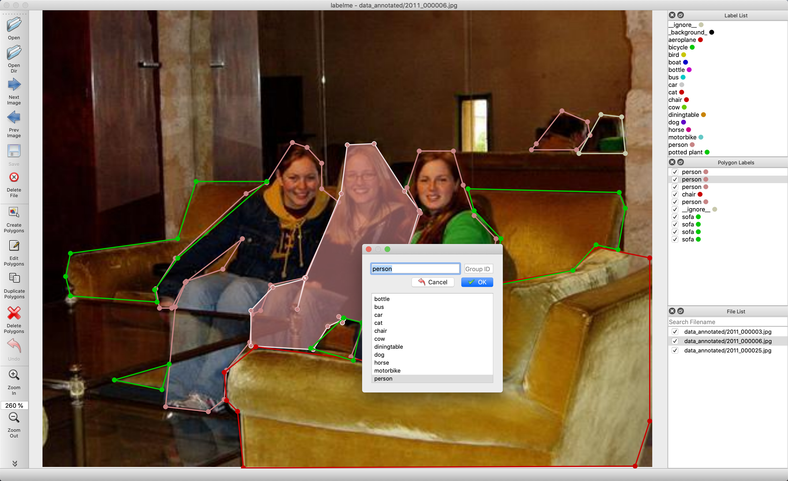
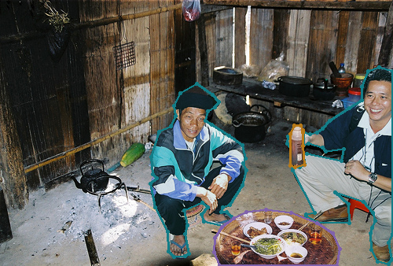

<div align="center">

# LabelMe with automatic per-class masks

**Annotate polygons once. Save editable JSON and a separate mask for each label.**

[](https://github.com/wkentaro/labelme/tree/v5.3.1)
[](labelme/label_file.py)
[](LICENSE)

[See the difference](#original-tool-and-this-fork) · [Install](#install-this-fork) · [Use it](#annotate-and-save) · [Output details](#understand-the-outputs)
</div>

This fork extends [Kentaro Wada’s LabelMe](https://github.com/wkentaro/labelme) with **automatic per-class mask export when annotations are saved**. The original editable JSON is retained, and the added `save_mask()` function rasterizes shapes into a separate mask for each label.

The normal annotation interface remains the starting point. The contribution is in the save workflow, implemented in [`labelme/label_file.py`](labelme/label_file.py).
<a id="original-tool-and-this-fork"></a>
## :vs: Original tool and this fork

The original tool already supports mask conversion through a separate export workflow. This fork makes per-class raster outputs part of the save action. The comparison is with the matching v5.3.1 source, not every later upstream version.

| Workflow | Original LabelMe v5.3.1 | This fork |
| --- | --- | --- |
| Draw and edit labelled polygons | Yes | Yes |
| Save annotation JSON | Yes | Yes |
| Automatically write one mask per label during normal save | Not in the compared save method | Added by `save_mask()` |
| Convert saved JSON through an export command | Available | Retained |
| Preserve separate objects within a single label mask | Depends on export workflow | Custom masks merge shapes sharing a label |

## :pencil2: The familiar annotation interface



*Existing repository screenshot from the inherited semantic-segmentation example. It illustrates the annotation interface; it is not a new capture of the modified save action.*

For the worked example below, the source image and polygon coordinates come from [`examples/semantic_segmentation/data_annotated/2011_000003.json`](examples/semantic_segmentation/data_annotated/2011_000003.json).



*Existing polygons visualized on their source image: `person` in teal, `bottle` in gold, and `__ignore__` in purple. These boundaries are read from the repository JSON, not generated annotations.*
<a id="install-this-fork"></a>
## :package: Install this fork

Clone and install **this repository**, rather than installing the unmodified PyPI release:

```bash
git clone https://github.com/shahrukh27/labelme.git
cd labelme
python -m pip install -e .
labelme
```

Use an isolated Python environment with a supported Qt binding. The inherited setup uses `distutils`, so Python 3.10 is a practical starting point for checking this older source. A complete GUI installation has not been validated by this documentation update.

The repository declares `scikit-image` in `setup.py`; the custom exporter uses `polygon2mask` and `imsave` from that library. The source LabelMe version: 5.3.1. 
<a id="annotate-and-save"></a>
## ▶️ Annotate and save

1. Open a **PNG** image and draw polygon annotations.
2. Assign each polygon a consistent class label, such as `water`, `person`, or `bottle`.
3. Save the annotation JSON in the **same folder as the image** for the simplest compatible path layout.
4. Inspect the JSON and generated `mask_<label>_<image filename>` files.
5. Reopen each mask and verify dimensions and pixel values before using it in training.

The function does not provide a new export dialog. It runs after JSON writing inside `LabelFile.save()`. Use polygon shapes for this custom export; it does not dispatch rasterization according to `shape_type`.
<a id="understand-the-outputs"></a>
## :brain: Understand the outputs


The example contains **five polygons with three distinct labels**: three `person` polygons, one `bottle`, and one `__ignore__`. The fork produces three masks, not five. Shapes sharing the same label are combined into one class mask; object `group_id` values are not retained in those custom mask files.

The current function treats `__ignore__` as an ordinary label and writes a mask for it. It does not automatically interpret it as an ignore index or exclude it from training.

| Output | Meaning |
| --- | --- |
| `example.json` | Editable polygon points, labels, image metadata, and other annotation fields. |
| `mask_person_example.png` | Union of all polygons labelled `person`. |
| `mask_bottle_example.png` | Polygons labelled `bottle`. |
| `mask___ignore___example.png` | Polygons labelled `__ignore__`, with no special handling. |

The custom function builds Boolean arrays with image height and width, converting JSON `[x, y]` points to the `[row, column]` convention required by `polygon2mask`. In the verified PNG example, files reopen as `uint8` arrays with values **0 and 255**. The serializer and image format determine the stored representation, so do not assume files contain numeric 0 and 1 without checking them

### Filename rule

The current code constructs:

```python
os.path.join(
    os.path.dirname(json_filename),
    "mask_" + label + "_" + data["imagePath"]
)
```

Labels are used literally; they do not need to be numeric. For label `water` and `imagePath="tile.png"`, the result is `mask_water_tile.png`. Keep image filenames simple and colocate image and JSON files. Relative subdirectories and separators in labels can produce invalid or unintended output paths under the current concatenation rule.

## :warning: Implementation notes and limits

- **Polygon rasterization:** all shapes are sent to `polygon2mask`; the custom exporter does not implement separate rectangle, circle, line, or point handling.
- **Only present labels:** no empty mask is created for a class absent from the annotation. An annotation with no shapes produces no custom masks.
- **Stale outputs:** deleting or renaming a label does not remove an older mask file from disk.
- **Save order:** JSON is written before masks. A mask export failure can leave a JSON file even if the operation reports an error.
- **Paths and encoding:** output names use literal labels and `imagePath`; check filename handling and reopened pixel values in your environment.
- **.png masks:** current mask type is same as input file; saving all mask files explicitly as a .png will be implemented later.

### Read a mask safely

```python
import numpy as np
from PIL import Image

mask = np.asarray(Image.open("mask_person_example.png"))
print(mask.shape, mask.dtype, np.unique(mask))
foreground = mask > 0  # Appropriate for the verified 0/255 PNG example.
```

For JPEG masks, select an appropriate recovery policy rather than relying on `mask > 0`: compression can introduce small nonzero background values. Prefer regenerating lossless masks from the JSON.

## 🌊 Relationship to PAKSEN2

The [PAKSEN2 dataset page](https://github.com/rafiamalik12/PAKSEN2_Water_Dataset) links to this modified LabelMe fork for saving binary water masks from polygon annotations. The associated paper describes LabelMe annotation as part of dataset preparation.

The demo on this page uses a fully specified repository example because its original polygons can be inspected and its masks reproduced. It does not invent water polygons or claim to reconstruct missing PAKSEN2 annotations.

Related paper: R. Malik, M. Shahzad, and S. Malik, “Supervised Classification of Water Bodies: Analyzing Various Methods Through a Case Study of Water Resources in Pakistan,” *2023 20th International Bhurban Conference on Applied Sciences and Technology (IBCAST)*, pp. 339–344, 2023. [DOI](https://doi.org/10.1109/IBCAST59916.2023.10712981).

This paper is the related PAKSEN2 application, not the original publication or sole citation for LabelMe.

## 🤝 Attribution and further examples

Original tool: [wkentaro/labelme](https://github.com/wkentaro/labelme), by Kentaro Wada and contributors. This fork adds the per-class save behavior described above. Preserve the existing [GPL-3.0-or-later license](LICENSE) and upstream copyright notices.

Inherited examples remain available for [single-image annotation](examples/tutorial), [semantic segmentation](examples/semantic_segmentation), [instance segmentation](examples/instance_segmentation), [bounding boxes](examples/bbox_detection), and [video annotation](examples/video_annotation). Their upstream capabilities should not be confused with shape support in the custom `save_mask()` function.

